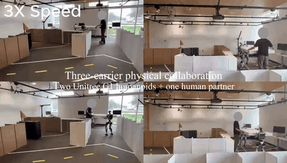
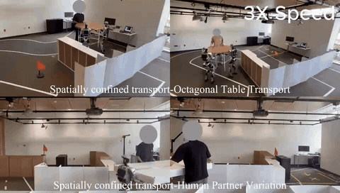

# SAGE: Safety-Aligned Gradient Enforcement for Human–Robot Collaboration

<p align="center">
  <a href="https://arxiv.org/abs/2609.21130"></a>
  <a href="https://arxiv.org/pdf/2609.21130"></a>
  <a href="https://yisen03-explosion.github.io/sage/"></a>
</p>

<table>
  <tr>
    <td align="center" width="50%">
      <br>
      <sub><b>Scenario 1:</b> Three-carrier physical collaboration — two Unitree G1 humanoids + one human partner</sub>
    </td>
    <td align="center" width="50%">
      <br>
      <sub><b>Scenario 2:</b> Spatially confined transport — octagonal table and human-partner variation</sub>
    </td>
  </tr>
</table>

Reference implementation and training recipe for **SAGE** on an Isaac Lab task in
which **N = 3** Unitree G1 humanoids carry one rigid board through a 2.2 m tilt
gate. Each carrier's high-level policy is a **hard oblique decision tree**. Every
executed command passes through an exact control-barrier QP that covers the whole
formation. **SAIL** (shield-annealed internalisation) and **TALO** (team-averaged
Lyapunov policy optimisation) train the trees so that the deployed tree relies on
the shield as little as possible, and the separately parameterised carriers
update as a team.

This repository contains code and the training recipe only. It ships no trained
checkpoints, results or curves. Every arm below is trained from the same
initialisation with one command.

## Quick start

```bash
git clone https://github.com/yisen03-explosion/SAGE.git && cd SAGE
bash install.sh                    # conda env + pinned packages + pinned Isaac Lab + CPU smoke test
conda activate isaac_sage
export OMNI_KIT_ACCEPT_EULA=YES    # after reading the NVIDIA Omniverse EULA
bash train.sh sage                 # one arm (200 iterations)
bash train.sh all                  # tree, tree_cbf, sail, talo, sage, one after another
bash eval.sh results/sage_seed1_<date>     # deployment evaluation of models/iter_200.pt
```

Each run writes `results/<arm>_seed1_<date>/`:

| Path | Contents |
|---|---|
| `run_args.json` | every flag of the run |
| `train.log` | console output |
| `tensorboard/` | training logs |
| `models/iter_<k>.pt`, `models/latest.pt`, `best_model.pt` | checkpoints |

`eval.sh` writes `eval_iter_200.json` next to them. A run that crashes is
restarted from its latest checkpoint automatically (`isaac_sage/run_resumable.sh`).

## Requirements

- Linux x86_64 with glibc ≥ 2.34 (e.g. Ubuntu 22.04), an NVIDIA RTX GPU and a recent driver
- conda (Miniconda / Miniforge) and git
- Run time: one iteration takes about 2.5 min as the only job on one RTX 4070 Ti SUPER (16 GB),
  so one arm (200 iterations) takes about 8 h and `train.sh all` about 40 h.
- Internet access during `install.sh`. It installs Isaac Sim from `pypi.nvidia.com`
  and torch from the PyTorch cu124 index.

### Pinned simulator stack

The carriers' closed-loop behaviour depends on the Isaac Lab version, so every arm
must use exactly this stack. `install.sh` sets it up:

| Component | Version |
|---|---|
| Isaac Sim | 4.5.0 pip wheels (kit `4.5.0-rc.36`) |
| Isaac Lab | `isaac-sim/IsaacLab` at commit `3e73d6dd79080fd7632488c061052a6edd52e230` (2026-05-07, `VERSION` 2.3.2), checked out to `third_party/IsaacLab` |
| Python packages | `requirements.lock.txt` (Python 3.10, torch 2.5.1+cu124) |

Isaac Lab is **not** pip-installed. Its `setup.py` at that commit would upgrade
torch. Instead, `ISAACLAB_CORE_ROOT` (set by `train.sh` / `eval.sh`) makes the
`isaaclab*` packages import from the checkout. That commit ships
`apps/isaacsim_4_5`, so it starts on Isaac Sim 4.5. This combination is not in
Isaac Lab's official support table, but it is the stack the recipe was run on.
Do not substitute an official Isaac Lab release.

## Repository layout

```
install.sh  train.sh  eval.sh  requirements.lock.txt  pyproject.toml
isaac_sage/
  safety.py        formation CBF rows (collision, grasp, rotation, workspace) and the exact joint QP
  tree_policy.py   one hard oblique tree per carrier: hard routing, straight-through gradients, tanh-normal proposal
  sail.py          SAIL penalty map, differentiable damped-Newton iterations
  talo.py          g_ind, g_team, W_gap and the half-space projection giving g_TALO
  critic.py        team-context critic and plain joint-observation critic
  trainer.py       the five variants and both actor updates (Algorithm 1); deployment controller (Algorithm 2)
  isaac_env.py     adapter to the Isaac Lab task
  train_sage.py    training entry point
  eval_sage.py     deployment evaluation entry point
  scenes.py        generates scenes/tilt_gate_2m2.json
  smoke_test.py    CPU checks of the equations and two iterations of every variant (no simulator)
  task/            Isaac Lab task Isaac-G1-CooperativeTransport-Direct-v0 (registered on import)
  assets/g1/g1_29dof_anneal_23dof_palmup.usd     G1 robot (23 actuated DoF)
  assets/policy_waist_tracking_g1_23dof.pt       frozen waist-tracking whole-body controller (TorchScript)
  assets/init/phase1_init.pt                     phase-1 initialisation (see below)
  scenes/tilt_gate_2m2.json                      training scene
```

`isaac_sage` depends only on PyTorch and Isaac Lab and contains no other learning
framework.

## Task

- **Robots.** N = 3 G1 robots hold a 2.0 m × 1.0 m board. Each robot is driven
  at 50 Hz by the frozen waist-tracking controller (`assets/policy_waist_tracking_g1_23dof.pt`),
  which follows a body-frame target `[dx, dy, dyaw]`.
- **Learning carriers.** `robot_0` and `robot_1` stand at ±1.2 m along the board's
  X axis and learn the 1 Hz high-level command.
- **Follower.** `robot_2` stands 0.7 m along the board's Y axis. It is tied
  rigidly to the payload and enters only the safety constraints, as a disc
  attached to the payload. It is not a decision block.
- **Observations.** Each carrier observes its own state, the board and waypoint
  window, and 36 synthetic LiDAR rays.

**Footprint model** (`scenes.py`, used by the safety layer):

- robot discs of radius 0.2 m
- formation width across the direction of travel: about 1.40 m carried lengthwise, about 2.80 m broadside
- safety-layer margin to walls: 0.10 m

**Training scene: 2.2 m tilt gate** (`scenes/tilt_gate_2m2.json`).

- **Geometry.** A gate 2.2 m wide and 2.1 m deep. Travel is along +Y, and the
  formation enters with its broad side facing the gate.
- **Required rotation.** To pass, the formation must tilt its long axis towards
  the travel direction:
  - within about 48.5° of it to fit through the opening at all
  - within about 36.5° of it to keep the 0.10 m margin to both gate walls
- **Episodes.** Start and goal are drawn from a pool of 512 validated spawn
  poses. The episode budget is 150 s (150 high-level steps).

Regenerate the scene with `python -m isaac_sage.scenes --png`.

## The five arms

All arms share every setting except the three columns below.

| Arm | `--variant` | Safety layer | Actor update | Critic |
|---|---|---|---|---|
| tree | `tree` | none | HAPPO (`--actor_update happo`) | joint-observation (`auto`) |
| tree_cbf | `tree_cbf` | CBF-QP | HAPPO (`--actor_update happo`) | joint-observation (`auto`) |
| SAIL | `sail` | CBF-QP + SAIL | HAPPO (`--actor_update happo`) | joint-observation (`--critic joint`) |
| TALO | `talo` | CBF-QP + TALO | g_TALO (flag not passed) | team-context (`auto`) |
| SAGE | `sage` | CBF-QP + SAIL + TALO | g_TALO (flag not passed) | team-context (`auto`) |

Two flag rules:

- The TALO arms always update with g_TALO, and the code rejects `--actor_update happo` for them.
- SAIL needs `--critic joint` explicitly, because `auto` would give it the team-context critic.

**HAPPO update** (Kuba et al., ICLR 2022), as implemented in `trainer.py`:

1. Each iteration draws a random order of the two carriers.
2. The carriers are updated one after another. Each uses its own clipped PPO
   ratio and its own gradient clipping.
3. The ratios of the carriers already updated multiply the advantage of the
   carriers updated after them.
4. The critic is updated after all carriers.

In the SAIL arm one carrier's proposal centre depends on the other carrier. While
one carrier is updated, the other is held at its current parameters, so SAIL with
HAPPO is a sequential approximation, not an exact joint update.

### Shared recipe (`train.sh`)

| Setting | Value |
|---|---|
| Iterations | 200 iterations of 128 parallel envs × 60 high-level steps = 7,680 env-steps each, i.e. `--num_env_steps 1536000`. The τ and κ schedules are fractions of this total, so a run must not be stopped early or lengthened. |
| Seed and scene | `--seed 1`, `--scene_json isaac_sage/scenes/tilt_gate_2m2.json` |
| Gate temperature τ (straight-through backward pass) | `--tau_init 2.0 --tau_final 0.4 --tau_anneal_start 0.112 --tau_anneal_end 0.36` |
| Routing | `--hard_finetune_fraction 1.0`: hard routing from the first iteration (forward pass), straight-through gradients through sigmoid(·/τ) (backward pass), and hard routing at deployment. Because there is no soft → hard switch, split hyperplanes and leaves are trained throughout and the actor learning rate is never rescaled. |
| SAIL κ | `--kappa_init 8 --kappa_final 32`, linear over the whole run |
| Reward | `--w_heading 0 --w_obstacle 0 --w_collision_contact 0.2`, `--projection_progress --success_mode loose --success_compensation` |
| Start curriculum | `--start_curriculum_prob 0.7`. The lower bound of mid-path starts anneals from 0.8 to 0.0 over the first 60 % of training. |
| Partner perturbation | `--partner_noise` |
| Optimisation | `--actor_lr 1e-4 --critic_lr 5e-5`; PPO 15 epochs × 15 minibatches, `max_grad_norm 0.5`, entropy coefficient 0 (code defaults) |
| Safety layer | `--obstacle_margin 0.1` |
| Simulator | `--headless` |

### Initialisation

All five arms continue from the same phase-1 policy:
`--resume isaac_sage/assets/init/phase1_init.pt --activate_lidar`.

- **Contents.** The file holds the carrier trees, a team-context critic and the
  observation normaliser. It is an initialisation, not a checkpoint of any arm.
- **LiDAR channels.** The phase-1 policy saw no LiDAR input. `--activate_lidar`
  zeroes those weights and re-estimates their normalisation; this leaves the
  initial policy unchanged.
- **TALO, SAGE.** The critic kind matches, so the critic is loaded and the actor
  updates from iteration 1.
- **tree, tree_cbf, SAIL.** These use the joint-observation critic, so the critic
  starts from scratch. The actor is frozen for the first `--critic_warmup_iters 5`
  iterations.

Training without this file starts from a random tree. That is a different
experiment from this recipe.

## Checks without a simulator

```bash
python -m isaac_sage.smoke_test
```

The smoke test checks, on CPU:

- the CBF rows, the exactness and idempotence of the QP, and the fixed-block QP
- the SAIL sensitivity, the straight-through tree routing and the TALO descent condition
- two training iterations of every variant on a planar stand-in environment

## License

The code is released under the MIT License ([LICENSE](LICENSE)). The bundled G1 robot
model is derived from Unitree's G1 description (BSD 3-Clause) and ASAP's 23-DoF G1
description (MIT); see [NOTICE](NOTICE).

## References

- HAPPO: J. G. Kuba et al., *Trust Region Policy Optimisation in Multi-Agent Reinforcement Learning*, ICLR 2022.
- Isaac Lab: M. Mittal et al., *Isaac Lab: A GPU-Accelerated Simulation Framework for Multi-Modal Robot Learning*, arXiv:2511.04831, 2025.
